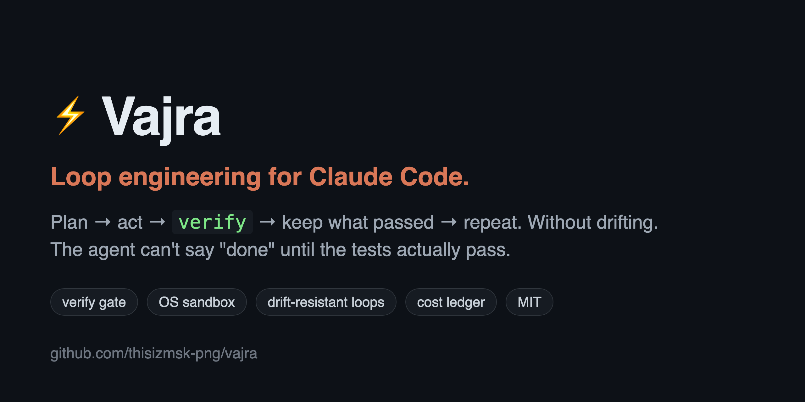

<div align="center">



### Ask in, finished work out, with the evidence attached.

[](LICENSE)
[](.github/workflows/ci.yml)
[](https://code.claude.com/docs)
[](#install)

</div>

---

Vajra is a harness for Claude Code. You type `/vajra <ask>`. A saved Claude
Code workflow turns it into acceptance criteria, a plan with an owner agent per
task, parallel work in git worktrees, real checks against every criterion, up
to three fix rounds, and a local branch with a delivery report. Push, PR and
deploy come back as a plan for you to approve.

Most of Vajra is a small amount of code wired into native Claude Code
primitives: hooks, saved workflows, subagents and plan mode. Every claim below
points at the file that does it and the test that checks it.

## Install

Run these in your own terminal, not through Claude Code (once the hooks are
installed, Vajra's guard blocks the model from running the installer or
regenerating the manifest):

```bash
git clone https://github.com/thisizmsk-png/vajra.git ~/.claude/skills/vajra
bash ~/.claude/skills/vajra/scripts/install.sh         # --dry-run to preview, --no-hooks to skip hook registration
bash ~/.claude/skills/vajra/scripts/install-skills.sh  # REQUIRED: the 20 mahabharat agents (and the bundled skills)
bash ~/.claude/skills/vajra/scripts/vajra-doctor.sh    # PASS/FAIL for each piece of wiring
```

`install.sh` does the following:

- creates `~/.claude/vajra/` and a random HMAC key (`openssl rand -hex 32`, mode 600);
- edits `~/.claude/settings.json`, but only its `hooks` section: it merges
  Vajra's hooks in, keeps your own hooks and writes a timestamped backup first
  (`--dry-run` shows the change, `--unregister-hooks` removes it again);
- copies the workflows to `~/.claude/workflows/`;
- signs the file manifest with your own key.

**The 20 mahabharat agents are required**, not an extra. `/vajra <ask>` and
every crew delegate to them by name (bhima, nakula, vidura, arjuna and the
rest), so without them in `~/.claude/agents/` the workflows can't run.
`install-skills.sh` copies them from `bundled-agents/` (skipping any you
already have), or install them with the
[mahabharat-agents](https://github.com/thisizmsk-png/mahabharat-agents)
installer (its `scripts/install.sh --target user` puts them in
`~/.claude/agents/`). `vajra doctor` checks that they are present.

Optional:

```bash
bash ~/.claude/skills/vajra/scripts/enable-sandbox.sh  # turn on Claude Code's OS sandbox (recommended for unattended runs)
```

**Needs:** Claude Code with hooks and saved workflows (docs checked against
2.1.296), git, bash, python3, jq and openssl, on macOS or Linux/WSL2. The
installer needs jq and openssl, not Node.js; Node.js is only needed to run the
TypeScript tests.

## Using it

| You want to | Type |
|---|---|
| Get something built, end to end | `/vajra <ask>` |
| See and edit the plan before anything runs | `/vajra plan <task>` |
| Run a specific crew | `/vajra fleet feature-build \| security-audit \| incident-response \| architecture-review \| sabha <brief>` |
| Resume or inspect long work | `/vajra continue` · `/vajra status` · `/vajra campaign ...` |
| Prove a change works | `/vajra verify-work <slug> "npm test" "npm run build"` |
| Run a long job with a fresh context each iteration | `/vajra ralph <progress.md>` |
| Review the diff against the steering rules | `/vajra review` |
| See what a session cost | `/vajra cost` |
| Review what Vajra learned | `/vajra atman review`, then `approve <id>` or `reject <id>` |
| Teach Vajra a project fact | `/vajra remember the API uses cursor pagination` |
| Look up project knowledge | `/vajra kb search <words>` · `/vajra kb pending` |
| Check the wiring | `/vajra doctor` |
| Everything else | `/vajra help` |

Each subcommand has a one-page doc in [`docs/commands/`](docs/commands/).

## What is enforced by code

| Claim | Where | Test |
|---|---|---|
| Routing costs 0 model tokens: a UserPromptSubmit hook adds one context line with suggested crews, agents and skills, and logs the route (no raw prompt) | `scripts/vajra_route.py`, `hooks/user-prompt-submit.sh`, `config/default.json` | `tests/router/run-router.sh` |
| Project knowledge is a ledger: append-only HMAC-chained events, an FTS index, a write gate that refuses secrets, injection and oversize text, and trust tiers (user only from `/vajra remember`, verified only with green evidence, everything else pending your approval). It is read back at session start and on each `/vajra` ask as `<untrusted-data>` pointers | `scripts/vajra_kb.py`, `hooks/session-start.sh`, `scripts/vajra_route.py` | `tests/kb/`, `tests/router/run-router-kb.sh`, `tests/hooks/run-session-start-kb.sh` |
| Deliveries plan into a task graph (`tasks.json`, only the script changes a status), run in dependency waves with disjoint files (at most 4 in flight), close a task only on vidura's verdict, and on verified success write the delivery, decisions and lessons back to the ledger | `scripts/vajra_tasks.py`, `workflows/vajra-deliver.js` | `tests/tasks/`, `tests/workflows/` |
| A bare `/vajra <ask>` runs the deliver workflow: understand, plan, execute in worktrees, verify, fix (at most 3 rounds), deliver | `workflows/vajra-deliver.js` | `tests/workflows/` |
| Crews are saved workflows with typed outputs, bounded fix loops, read-only reviewers and a vote counted in code | `workflows/vajra-*.js` | `tests/workflows/` |
| Dangerous or self-modifying tool calls are blocked (exit 2, fail closed); paths are canonicalized; config, settings, agents and Vajra state (including the knowledge ledger and task graphs) are protected; only real write targets are judged, not text in heredocs or quoted reader arguments; cost is bounded for large commands | `hooks/pre-tool-use.sh` | `tests/hooks/` |
| "Done" needs at least one passing command, with output and the diff against `HEAD` (plus untracked files) captured | `scripts/vajra-verify-work.sh` | `tests/run-verify-work.sh` |
| Campaigns persist across sessions in `features.json` (only `passes` changes) and `progress.md`, with HMAC-signed checkpoints; the key never enters the model context | `scripts/vajra-campaign.sh` | `tests/run-campaign.sh` |
| The manifest is signed locally with your key and checked at session start | `scripts/generate-manifest.sh`, `hooks/session-start.sh` | `tests/hooks/` |
| Atman learns from real tool failures and verify-work results, writes proposals only, and changes nothing until you approve | `hooks/post-tool-use.sh`, `scripts/atman.sh` | `tests/atman/` |
| Cost ledger per transcript, deduplicated by message id, priced from `config/pricing.json` | `scripts/vajra-cost.sh` | `tests/run-cost.sh` |

Specialists are the 20 mahabharat agents (17 masters, 3 sepoys) in
`bundled-agents/`. Vajra delegates to them through the Agent tool or a
workflow's `agentType`, so each agent's own tool allowlist, model and effort
apply. Claude Code's native auto memory keeps user preferences; project
knowledge lives in Vajra's ledger, where every record says where it came from.

Not enforced by code: wrapping untrusted content (files, web pages, tool
output, other agents) in `<untrusted-data>` tags is an instruction in
`SKILL.md` that the model follows. `engine/sanitizer.ts` is a reference
implementation of that wrapping, tested in CI (`tests/sanitizer.test.ts`), but
nothing calls it at runtime.

## Safety, honestly

- The **OS sandbox** (Claude Code's Seatbelt or bubblewrap sandbox) is the real
  boundary, and it is opt-in: run `scripts/enable-sandbox.sh`.
- The pre-tool hook is defense in depth. It blocks known-dangerous commands and
  writes to Vajra's own policy files, but a pattern match over free-form shell
  can't be a complete control on its own.
- Workflows and crews never push, open PRs, deploy, run migrations, touch
  secrets, spend money or send messages. They return a plan, and you approve it
  through Claude Code's permission prompt.
- Atman never edits `config/` or the skill. Approved routes go to
  `~/.claude/vajra/learned-routes.json`; approved skill changes become patch
  files that you apply with git.

See [SECURITY.md](SECURITY.md) for the full model.

## Limits

- Claude Code only.
- macOS and Linux/WSL2; native Windows is not supported.
- Verification is only as good as the checks. Vajra proves the checks passed,
  not that they are sufficient.
- Routing suggestions are regex and learned-word matches. The deliver workflow
  makes the final plan.
- A young project, built by one person.

## Contributing

```bash
npm install            # vitest, only for the TypeScript tests
bash tests/run-all.sh  # vitest plus every tests/**/run-*.sh suite; CI runs the same
```

See [CONTRIBUTING.md](CONTRIBUTING.md) and the architecture notes in
[docs/architecture/ARCHITECTURE.md](docs/architecture/ARCHITECTURE.md).

<div align="center">

MIT licensed.

</div>
