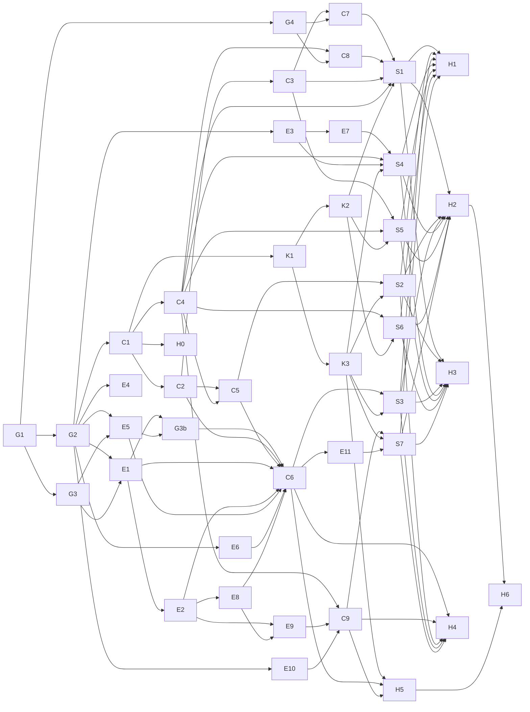

# Vajra Desktop: MVP tasks (spec phase 3)

Status: draft. **No task here starts before the two-model gate approves the stack and design**
(Opus 5.5 author, GPT 6.1 Sol reviewer). Engine tasks E3 to E2 change Vajra itself and need the owner's
approval as a separate PR.

Inputs: [requirements.md](requirements.md) (US, AC, NFR ids), [design.md](design.md) (components,
control channel, ADRs), [../UX.md](../UX.md), [../DESIGN.md](../DESIGN.md).

## How to run this plan

The plan is shaped for `/vajra`: each task has one owner agent, the files it may change (disjoint within a
wave), its dependencies and the acceptance ids it must prove. Owners are **engine ids**, because
`scripts/vajra_tasks.py validate` rejects unknown agents; the UI role name is in brackets. Suggested asks,
one per milestone, so each run stays reviewable:

1. `/vajra` M1 engine changes (E3 to E2), in this repo.
2. `/vajra` M2 core (C1 to C6), then M3 kit (K1 to K3), then M4 screens (S1 to S6), then M5 hardening (H1 to H6).

`app/` is the working path for the app inside this repo (open: a separate repo; see Q9 below). The paths
under `app/` are placeholders until the spike fixes the stack: `core/` is the Rust (or chosen) backend,
`ui/` the renderer.

## Milestones and tasks

### M0 Gate (no code)

| Id | Task | Owner | Files | Deps | Done when |
|---|---|---|---|---|---|
| G1 | Stack spike: measure candidates against Agent Orchestrator desktop and Orca on this Mac; answer design.md section 2 | GPT 6.1 Sol spike worker (outside Vajra) | spike report | none | Report has measured idle RSS, RSS per agent, cold start, frame time at 10 agents |
| G2 | **Done 2026-11-05 for the stack** (both models approve Tauri v2 + Rust + React/TS + xterm.js; performance approval withheld by both until NFR-PERF-1 and NFR-PERF-6 are met). Review: `vajra-3/stack-spike-review.md`, objections O1-O7 feed H1 | Opus 5.5 + GPT 6.1 Sol | `docs/desktop/spec/requirements.md`, `docs/desktop/PRD.md` | G1 | Stack approved by both; budgets in NFR-PERF-1 to 10 |
| G3 | **Confirmed 2026-11-05** by vajra-6's tracer bullet (Claude Code 2.1.296, artifact `vajra-6/tracer-bullet.md`): Claude Code facts the control channel depends on (design.md 5.9) | abhimanyu [Prototyper]; done by vajra-6 | none (spike notes) | G1 | Done: subagent hook payloads carry `session_id`, `agent_id`, `agent_type`, `cwd`; `additionalContext` reaches the subagent when sent as a nonce-tagged steer (plain text is ignored as injection); exit 2 from a second PreToolUse hook blocks the call; `--resume` plus `SendMessage` continues the same agent. Still open: the same inside the `vajra-deliver` Workflow tool (M2 smoke run) |
| G3b | Validation gate, run after E1 and E5 are built (A1 B3): one-task `vajra-deliver` run with the control hook and E5, checking step labels and `agent_id` in hook payloads, nonce steer delivery, sticky stop with the final-output exemption, and the MCP naming (design 5.9 items 9 to 11) | abhimanyu [Prototyper] | spike notes only | E1, E5 | Each item confirmed (POS-5.5); a finding (for example another final-output tool name, design 5.4) goes back to E1 as a fix and G3b reruns, and C6 starts only after G3b passes; if steering fails on this path, J3 ships as stop-only (ADR-2 fallback) and steering claims stay limited to Agent-tool subagents |
| G4 | Spike: Codex CLI (`codex` version, PTY streaming, process-group stop, any supported inspect, message or resume hook) and Conductor's on-disk layout for repos, worktrees and sessions | abhimanyu [Prototyper] | spike notes only | G1 | Each Codex capability flag set from a run, not docs; Conductor paths confirmed or the import ships git- and transcript-only |

### M1 Engine changes (Vajra repo, owner-approved)

| Id | Task | Owner | Files | Deps | Acceptance |
|---|---|---|---|---|---|
| E3 | `vajra_tasks.py check-evidence <evidence.json> [--head SHA] --json`: read-only, reuses the shared green check, returns `{ok, green, reasons}`, writes nothing | bhima [Backend] | `scripts/vajra_tasks.py`, `tests/tasks/run-check-evidence.sh` | G2 | AC-4.3.1, AC-4.3.3; test proves no file under the campaign changes |
| E5 | `vajra-deliver.js`: optional `steer_nonce` input and one fixed steering sentence in Execute-phase task briefs only (design 1.3) | bhima [Backend], reviewed by bhishma [Security] | `workflows/vajra-deliver.js`, `tests/workflows/*` | G2, G3 | AC-3.2.2; verify, review and merge briefs unchanged (test) |
| E4 | Persist the delivery report as `report.md` in the campaign through `vajra-campaign.sh` (Q3 approved 2026-11-05; vajra-6 engine work) | bhima [Backend] | `scripts/vajra-campaign.sh`, `workflows/vajra-deliver.js`, tests | G2 | History shows the report with the transcript format check forced to fail |
| E6 | (Approved 2026-11-05 under Q11; vajra-6 engine work) The worker's claim passes `--worktree "$PWD"` so `tasks.json` names each worker's worktree; the Control service matches workers on it and uses transcripts for display only (PM-7) | bhima [Backend] | `workflows/vajra-deliver.js`, `scripts/vajra_tasks.py`, tests | G2 | With the transcript format check forced to fail, message and stop still reach the right worker |
| E7 | Archive the verification bundle and the executed `setupCmds` (as `setup.json`) into the campaign before cleanup, with a signed manifest; E3 `--archived` (design 1.3; approved Q13) | bhima [Backend], reviewed by vidura [Verifier] | `scripts/vajra-campaign.sh`, `scripts/vajra_tasks.py`, `workflows/vajra-deliver.js`, tests | E3 | POS-1.2 tests: delivery with its worktrees cleaned still verifies and re-runs; setup command over 300 characters replayed byte for byte; a filtered-out setup entry is never run; every existing test passes |
| E8 | Sandbox profile (Q10 approved): the default `denyWrite` for the app data dir and control queue in `config/sandbox.json`, applied by `scripts/enable-sandbox.sh` and the Desktop first-run setup only after the user approves the change; `vajra-doctor.sh` reports it | bhima [Backend], reviewed by bhishma [Security] | `config/sandbox.json`, `scripts/enable-sandbox.sh`, `scripts/vajra-doctor.sh`, tests | E2 | AC-3.4.9, AC-3.4.10; every existing guard and sandbox test passes |
| E9 | Human-only desktop approval path for kb and Atman (ADR-12; approved Q14 with the conditions in AC-7.1.8) | bhima [Backend], reviewed by bhishma [Security] | `scripts/vajra_kb.py`, `atman/atman.py`, `hooks/pre-tool-use.sh`, tests | E2, E8 | AC-7.1.4, AC-7.1.6 to AC-7.1.8; a forged approval (no owner auth), a stale or reused one and a swapped record are refused; every existing kb, atman and guard test passes |
| E10 | Ledger `applied` events and `applied --json` (ids only) | sepoy-backend-1 [Backend worker 1] | `scripts/vajra_kb.py`, tests | G2 | AC-7.2.1, AC-7.3.2 |
| E11 | Atman signal source: the app's control ledger redirects; proposals only | sepoy-backend-1 [Backend worker 1] | `atman/atman.py`, tests | C6 | AC-7.4.3, AC-7.4.4 |
| E1 | `hooks/desktop-control.sh`: delivers queued control messages to the addressed worker at its next tool call (message, redirect as additional context; stop as a block with reason), consume-once with ack; no-op when the app is not installed | bhima [Backend] | `hooks/desktop-control.sh`, `hooks/hooks.json`, `tests/hooks/run-desktop-control.sh` | G2, G3 | AC-3.2.1, AC-3.2.2, AC-3.2.5, AC-3.3.4 to AC-3.3.6 (tests: `handback_exempt_exact`, `stop_sticky_after_handback`, `no_delivery_when_stopped`, `no_delivery_on_handback`, `stop_cleared_only_by_human`; vajra-6 611d969); fails open (no queue = exit 0), never touches the guard |
| E2 | Guard (approved by the orchestrator under Security review, 2026-11-05): the whole app data dir write-protected; worker reads of the control dir and `~/.claude/projects/` blocked (Read, Grep, Glob, LS, Bash readers, symlinks); log the app's MCP control tools in `audit.log`; the sandbox `denyWrite` itself is E8 (Q10 approved). Additive; done in vajra-6 611d969 | bhima [Backend], reviewed by bhishma [Security] | `hooks/pre-tool-use.sh`, `hooks/hooks.json`, `tests/hooks/run-guard-*.sh` | E1 | AC-3.2.3, AC-3.4.x, NFR-SEC-1; every existing guard test still passes |

Moved into M1 by pre-mortem PM-7: persist the delivery report as `report.md` in the campaign.

### M2 Core (no UI)

| Id | Task | Owner | Files | Deps | Acceptance |
|---|---|---|---|---|---|
| C1 | App skeleton per the approved stack; owner-only data dir under `~/Library/Application Support/`; log rotation | arjuna [Architect] | `app/` scaffold, `app/core/main.*`, build config, lockfiles | G2 | NFR-PERF-4 smoke (cold start measured), NFR-OBS-1 |
| C2 | Bounded event bus and per-stream tail (256 KiB, NFR-PERF-2) with disk spill and drop-to-snapshot for slow consumers | bhima [Backend] | `app/core/bus/*`, tests | C1 | NFR-PERF-2, NFR-PERF-5; property test: no reader ever blocks |
| C3 | Session supervisor: start the run session and the Lead chat session in PTYs owned by the Rust core (ADR-9: no daemon; closing the window keeps runs alive via the menu bar; Cmd-Q confirms when runs are active; resume offered after a quit or crash; updates wait for idle; App Nap activity assertion while runs are active, with a 30 min closed-window test; a TCC prompt test for repos under ~/Documents); argv from a fixed template with argument arrays; read-only by default; explicit "Take over"; reattach with no lost events | bhima [Backend] | `app/core/sessions/*`, tests | C1, C2 | AC-1.1.x, AC-2.2.4, NFR-SEC-4, POS-2.1 to POS-2.1c, POS-2.4 (argv test) |
| C4 | Vajra state reader + script bridge: campaigns, tasks, features, progress, checkpoints, audit.log, routing log through a path allowlist; shell-outs to `vajra-campaign.sh`, `vajra_tasks.py`, `vajra_kb.py`, `vajra-doctor.sh`, `git` | sepoy-backend-1 [Backend worker 1] | `app/core/vajra/*`, `tests/fixtures/campaigns/*` | C1 | AC-1.2.x, AC-1.3.x, AC-1.1.3, NFR-SEC-2, NFR-SEC-6; test: the app never opens `.hmac-key` (fs trace) |
| C5 | Transcript tailer + crew tree derivation (Lead, run, agents, sub-workers) from transcripts and `tasks.json`; schema-version check with raw fallback | bhima [Backend] | `app/core/crew/*`, `tests/fixtures/transcripts/*` | C2, C4 | AC-2.1.x, AC-2.2.1 to AC-2.2.3 |
| C6 | Control service: MCP server (`list_workers`, `inspect_worker`, `message_worker`, `redirect_worker`, `stop_worker`) over an owner-only socket, queue writer, control ledger | bhima [Backend] | `app/core/control/*`, tests | C2, C5, E1, E2, E5, E6, G3b, E8 | AC-3.1.x to AC-3.4.x, NFR-SEC-5, NFR-SEC-8 |
| C7 | Agent-adapter interface (ADR-10) with the Claude Code adapter (from C3) and the Codex CLI adapter (flags from G4); shared conformance suite; billing source per session; fixed argv and env allowlist | bhima [Backend] | `app/core/agents/*`, tests | C3, G4 | AC-1.5.1 to 1.5.3, AC-1.1.5 to 1.1.7, NFR-SEC-16 (test: no open of any credential path in an fs trace) |
| C8 | Conductor import (ADR-11): read-only discovery, per-item confirm, app-owned records only | sepoy-backend-1 [Backend worker 1] | `app/core/import/*`, fixtures | C4, G4 | AC-1.4.1 to 1.4.4 |
| C9 | Memory service: inbox and rules readers over `vajra_kb.py` and `atman.sh`, the LocalAuthentication approve sheet that writes single-use approvals (ADR-12), the local search over reports and archived evidence | bhima [Backend], reviewed by bhishma [Security] | `app/core/memory/*`, tests | C4, E9, E10 | AC-7.1.1 to 7.1.7, AC-7.2.2, AC-7.3.1 to 7.3.3, NFR-SEC-17 (test: no IPC command or MCP tool creates an approval) |

C4 runs in parallel with C2 and C3 (disjoint files). C5 waits for C4's fixtures.

### M3 Kit

| Id | Task | Owner | Files | Deps | Acceptance |
|---|---|---|---|---|---|
| K1 | Tokens (dark, light, ANSI) and the design-guard test (fails on raw hex/rgb, letter-spacing, inline colors outside token files) | nakula [Frontend] | `app/ui/theme/*`, `app/ui/tests/design-guard.*` | C1 | DESIGN.md contrast table reproduced by a test; guard baseline 0 |
| K2 | Standard kit: Text, Button, Card, Badge, Input, ListRow, Section, SegmentedControl, Switch, Sheet, AlertDialog, Toast, Skeleton, Separator, StatusDot | sepoy-frontend-1 [Frontend worker 1] | `app/ui/components/ui/base/*` | K1 | NFR-A11Y-1 (roles, labels, focus) per component |
| K3 | Desktop kit: Tabs, Table, Tooltip, Command palette, Resizable panes, Terminal pane (virtualized, ANSI sanitized, OSC 8 and OSC 52 off), Crew tree (role tree), EvidenceRow, ActionCard, Diff view | nakula [Frontend] | `app/ui/components/ui/desktop/*` | K1 | NFR-PERF-2, NFR-PERF-3, NFR-SEC-3, NFR-A11Y-2 |

K2 and K3 run in parallel (disjoint folders, so `vajra_tasks.py waves` puts them in one wave).

### M4 Screens

| Id | Task | Owner | Files | Deps | Acceptance |
|---|---|---|---|---|---|
| S1 | Home: start run, resume, preflight | nakula [Frontend] | `app/ui/screens/home/*` | C3, C4, K2, C7, C8 | US-1.1 to US-1.3 |
| S2 | Crew view with worker pane tabs and hop history | nakula [Frontend] | `app/ui/screens/crew/*` | C5, K3 | US-2.1 to US-2.4 |
| S3 | Chat with Lead (dock and full) with action cards | sepoy-frontend-1 [Frontend worker 1] | `app/ui/screens/chat/*` | C6, K3 | US-3.1 to US-3.4 |
| S4 | Run view: evidence view as the run's default (criteria with pass, fail, not run, stale, unverified; failing first; no green badge while any is red), human-only Re-run with confirm, then timeline and task graph | nakula [Frontend] | `app/ui/screens/run/*` | C4, E3, E7, K3 | US-4.1 to US-4.3, POS-1.1, POS-1.2, POS-1.2 (test: a check that needs setup passes on Re-run only with the recorded setup replayed), POS-1.3 (tests: tracked edit, untracked file, branch moved with unchanged evidence bytes), POS-1.5 |
| S5 | Approvals inbox | nakula [Frontend] | `app/ui/screens/inbox/*` | C3, C4, K2 | US-5.1 to US-5.3 |
| S6 | History and knowledge search (records used per run with tier and source; approve, reject, forget shown as a command to copy into the human's own terminal); Settings | sepoy-frontend-1 [Frontend worker 1] | `app/ui/screens/history/*`, `app/ui/screens/settings/*` | C4, K2 | US-6.1, US-6.2, POS-3.1, POS-3.2 |
| S7 | Memory screen: inbox with evidence, Approve / Approve always / Edit then approve / Reject / Forget, rules by scope, search, "what primed this session" | nakula [Frontend] | `app/ui/screens/memory/*` | C9, K3, E11 | US-7.1 to US-7.4 (render-as-text tests: bidi, zero-width, 2,000-character cap) |

Waves: S1, S4, S6 can share a wave (disjoint dirs; two Frontend workers run in parallel), then S2, S3, S5.

### M5 Hardening and red team

| Id | Task | Owner | Files | Deps | Acceptance |
|---|---|---|---|---|---|
| H0 | Perf CI from the first build (PM-3): every merge records idle RSS, WebContent RSS and a 10 min growth slope, and fails on a regression over 5 MiB. End of M3: if NFR-PERF-1 or NFR-PERF-6 is unmet on the K3 build, the owner picks a written budget revision, a stack change or a delay before M4; no budget edits after M4 starts | sepoy-test-1 [Test worker 1], karna [Numerics] | `app/bench/ci/*` | C1 | Numbers per merge in CI |
| H1 | Perf harness: 10+ concurrent agent fixture at 200 lines/s each, frame-time capture, 1 h soak with leak check (RSS, handles, fds), flamegraphs; same fixture against Agent Orchestrator desktop and Orca | sepoy-test-1 [Test worker 1], numbers checked by karna [Numerics] | `app/bench/*` | S1 to S7 | NFR-PERF-1 to NFR-PERF-10 with measured numbers; POS-4.1 to POS-4.6 (Runner and Orca medians with method) |
| H2 | E2E: Playwright click crawl on the renderer; screenshots 1280x800 and 960x600, dark and light; keyboard-only walkthrough of J1 to J6 | sepoy-test-1 [Test worker 1] | `app/ui/e2e/*`, `docs/design/after/*` | S1 to S7 | NFR-A11Y-2, NFR-UX-1, NFR-UX-2; 0 crashes, page errors, console errors, dead controls |
| H3 | Pre-mortem of the MVP launch | duryodhana [Critic] | report only | S1 to S7 | Ranked failure modes with owners |
| H4 | Security gate: threat model review of IPC, control queue, filesystem scope, secrets in streams, update channel, supply chain | bhishma [Security] | report only | C6, C9, S2, S3, S7 | Gate verdict; every finding has a task or a written acceptance |
| H5 | Exploit PoCs as failing tests: escape-sequence injection through agent output, control-queue tampering by an agent, socket from another uid, path traversal in the state reader, shell injection through ask text; memory approval (AC-7.1.8): forge, replay, race and post-auth content swap of the E9 approval file | shakuni [Red team] | `app/tests/security/*` | C3 to C6, K3, C9 | Each PoC fails before its fix and passes after |
| H6 | Regressions and accessibility on the final diff (WCAG 2.2 AA, VoiceOver) | vidura [Verifier] | report only | H2, H5 | NFR-A11Y-1 to NFR-A11Y-3 |
| H7 | Positioning measurements that gate launch claims: seeded false-"done" benchmark (20+ tasks with planted defects), review-time study design (5+ developers), repeated-task knowledge eval; plus CI checks that a terminal-started run appears in the app and that uninstalling leaves every campaign readable by the CLI | sahadeva [Analyst], benchmark tasks by sepoy-test-1 [Test worker 1] | `app/bench/positioning/*` | S1 to S7 | POS-1.4, POS-1.6, POS-3.3, POS-2.2, POS-2.3 (numbers reported; no target) |
| H8 | Live acceptance on the release candidate, run by the owner under their own Claude Code login (PM-2): L1 to L7, a 3-task `vajra-deliver` with message, redirect and stop, quit then resume, approve after resume, and an N to N+1 update with a run active. Pass or fail per item in a dated note; any fail blocks launch | abhimanyu [Prototyper] runs, vidura [Verifier] confirms | `app/bench/live/*` | E1 to E6, C6, S1 to S6 | Dated note, all items pass |

Packaging (signing, notarization, update feed) is a plan by hanuman [Platform] after H4; shipping it needs
the owner's yes.

## Shipping slices (GPT-8)

The MVP ships in two slices so the evidence loop reaches users before the rest. Slice 1 is the private
beta; slice 2 must land before the public launch.

| Slice | What a user gets | Tasks |
|---|---|---|
| 1 | Start a run or reattach to one (terminal-started too); the evidence-first run view with Re-run, stale and unverified; each worker's stream and diff; direct audited controls (message, redirect, stop, resume worker) and the Lead chat; the needs-you inbox | G1 to G4, E1 to E3, E5 to E8, C1 to C8, K1 to K3, S1, S2, S3, S4 without the task graph, S5, H0, H1, H2, H4, H5, H6 |
| 2 | Knowledge in the run view (records used, refusals); the Memory screen (inbox, owner-authenticated approve, rules, search; S7, C9, E9 to E11); the task graph view; history search; the claim studies that unlock launch wording | E4, E9 to E11, C9, S4 task graph (US-4.2), S6, S7, H3, H7, H8 |

Slice 1 needs E7 (approved under Q13, 2026-11-05). Slice 1 has no knowledge mutation, no graph view and no claim study. The 60-second demo (PRD section 1)
needs slice 2 only for its last beat. Every acceptance id stays; only the order changes.

## Dependency graph

## Test strategy

- **Unit:** each core module (bus, ring buffer, tree derivation, name mapping, evidence status) and each
  kit component (roles, labels, keyboard).
- **Integration:** fixture campaigns and transcripts under `tests/fixtures/` (passing, failing, missing and
  badly signed evidence; a stuck task; a resumed campaign), plus E1 driven by recorded hook payloads.
- **E2E:** Playwright on the renderer (H2).
- **Performance:** H1, run in CI on every merge for the short load, nightly for the soak.
- **Security:** H4 and H5, plus `cargo-deny` or `npm audit` on lockfiles in CI.
- **Coverage target:** core modules 80% lines; every AC id maps to at least one test (traceability check
  reads the AC ids from requirements.md and fails on any id with no test).

## Rollback

The app is additive and reads Vajra state; uninstalling it changes nothing in Vajra. E1 and E2 are the only
engine changes: E1 is a separate hook script that exits 0 without a queue, and `install.sh
--unregister-hooks` removes it with the other hooks; E2 is a revertible commit with its own tests. The
control channel ships behind a setting (off means the app is read-only plus start, resume and approve).

## Open

- Q9: `app/` in this repo, or a separate `vajra-desktop` repo? A separate repo keeps the engine's
  manifest and guard tests small; this repo keeps engine changes and app in one review.
