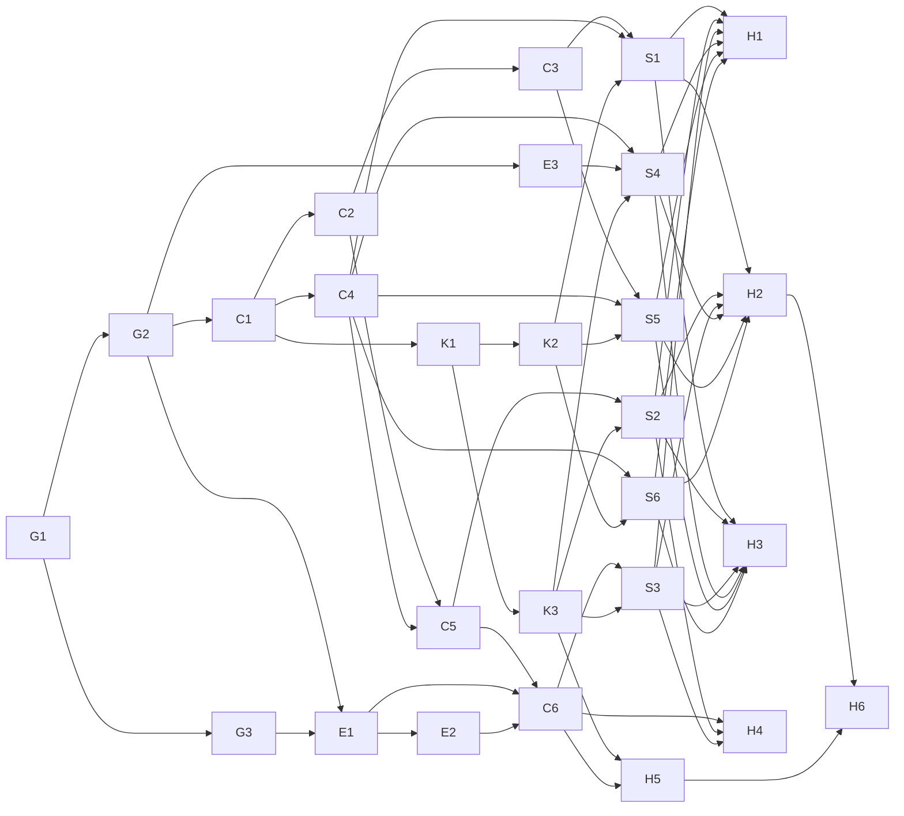

# Vajra Desktop: MVP tasks (spec phase 3)

Status: draft. **No task here starts before the two-model gate approves the stack and design**
(Opus 5.5 author, GPT 6.1 Sol reviewer). Engine tasks E3 to E2 change Vajra itself and need the owner's
approval as a separate PR.

Inputs: [requirements.md](requirements.md) (US, AC, NFR ids), [design.md](design.md) (components,
control channel, ADRs), [../UX.md](../UX.md), [../DESIGN.md](../DESIGN.md).

## How to run this plan

The plan is shaped for `/vajra`: each task has one owner agent, the files it may change (disjoint within a
wave), its dependencies and the acceptance ids it must prove. Owners are **engine ids**, because
`scripts/vajra_tasks.py validate` rejects unknown agents; the UI role name is in brackets. Suggested asks,
one per milestone, so each run stays reviewable:

1. `/vajra` M1 engine changes (E3 to E2), in this repo.
2. `/vajra` M2 core (C1 to C6), then M3 kit (K1 to K3), then M4 screens (S1 to S6), then M5 hardening (H1 to H6).

`app/` is the working path for the app inside this repo (open: a separate repo; see Q9 below). The paths
under `app/` are placeholders until the spike fixes the stack: `core/` is the Rust (or chosen) backend,
`ui/` the renderer.

## Milestones and tasks

### M0 Gate (no code)

| Id | Task | Owner | Files | Deps | Done when |
|---|---|---|---|---|---|
| G1 | Stack spike: measure candidates against Agent Orchestrator desktop and Orca on this Mac; answer design.md section 2 | GPT 6.1 Sol spike worker (outside Vajra) | spike report | none | Report has measured idle RSS, RSS per agent, cold start, frame time at 10 agents |
| G2 | Adversarial review of the spike; fill design.md Architecture and the budgets | Opus 5.5 + GPT 6.1 Sol | `docs/desktop/spec/design.md`, `docs/desktop/PRD.md` | G1 | Both models approve in the PR |
| G3 | Confirm Claude Code facts the design depends on ("to verify in spike" list in design.md) | abhimanyu [Prototyper] | spike notes only | G1 | Each item marked confirmed or replaced by its fallback |

### M1 Engine changes (Vajra repo, owner-approved)

| Id | Task | Owner | Files | Deps | Acceptance |
|---|---|---|---|---|---|
| E3 | `vajra_tasks.py check-evidence <evidence.json> [--head SHA] --json`: read-only, reuses the shared green check, returns `{ok, green, reasons}`, writes nothing | bhima [Backend] | `scripts/vajra_tasks.py`, `tests/tasks/run-check-evidence.sh` | G2 | AC-4.3.1, AC-4.3.3; test proves no file under the campaign changes. Status: implemented, awaiting independent verification |
| E1 | `hooks/desktop-control.sh`: delivers queued control messages to the addressed worker at its next tool call (message, redirect as additional context; stop as a block with reason), consume-once with ack; no-op when the app is not installed | bhima [Backend] | `hooks/desktop-control.sh`, `hooks/hooks.json`, `tests/hooks/run-desktop-control.sh` | G2, G3 | AC-3.2.1, AC-3.2.2, AC-3.2.5, AC-3.3.x; fails open (no queue = exit 0), never touches the guard. Status: implemented, awaiting independent verification |
| E2 | Guard: add the control queue dir as a protected root and log the app's MCP control tools in `audit.log` (additive only) | bhima [Backend], reviewed by bhishma [Security] | `hooks/pre-tool-use.sh`, `hooks/hooks.json`, `tests/hooks/run-guard-*.sh` | E1 | AC-3.2.3, AC-3.4.x, NFR-SEC-1; every existing guard test still passes. Status: implemented, awaiting independent verification |

Deferred, pending owner decision Q3 in PRD and E4 in design.md: persist the delivery report as `report.md` in the campaign.

### M2 Core (no UI)

| Id | Task | Owner | Files | Deps | Acceptance |
|---|---|---|---|---|---|
| C1 | App skeleton per the approved stack; owner-only data dir under `~/Library/Application Support/`; log rotation | arjuna [Architect] | `app/` scaffold, `app/core/main.*`, build config, lockfiles | G2 | NFR-PERF-4 smoke (cold start measured), NFR-OBS-1 |
| C2 | Bounded event bus and per-stream ring buffer (2 MB) with disk spill and drop-to-snapshot for slow consumers | bhima [Backend] | `app/core/bus/*`, tests | C1 | NFR-PERF-2, NFR-PERF-5; property test: no reader ever blocks |
| C3 | Session supervisor: start the run session and the Lead chat session in PTYs with argument arrays; read-only by default; explicit "Take over" | bhima [Backend] | `app/core/sessions/*`, tests | C1, C2 | AC-1.1.x, AC-2.2.4, NFR-SEC-4 |
| C4 | Vajra state reader + script bridge: campaigns, tasks, features, progress, checkpoints, audit.log, routing log through a path allowlist; shell-outs to `vajra-campaign.sh`, `vajra_tasks.py`, `vajra_kb.py`, `vajra-doctor.sh`, `git` | sepoy-backend-1 [Backend worker 1] | `app/core/vajra/*`, `tests/fixtures/campaigns/*` | C1 | AC-1.2.x, AC-1.3.x, AC-1.1.3, NFR-SEC-2, NFR-SEC-6; test: the app never opens `.hmac-key` (fs trace) |
| C5 | Transcript tailer + crew tree derivation (Lead, run, agents, sub-workers) from transcripts and `tasks.json`; schema-version check with raw fallback | bhima [Backend] | `app/core/crew/*`, `tests/fixtures/transcripts/*` | C2, C4 | AC-2.1.x, AC-2.2.1 to AC-2.2.3 |
| C6 | Control service: MCP server (`list_workers`, `inspect_worker`, `message_worker`, `redirect_worker`, `stop_worker`) over an owner-only socket, queue writer, control ledger | bhima [Backend] | `app/core/control/*`, tests | C2, C5, E1, E2 | AC-3.1.x to AC-3.4.x, NFR-SEC-5, NFR-SEC-8 |

C4 runs in parallel with C2 and C3 (disjoint files). C5 waits for C4's fixtures.

### M3 Kit

| Id | Task | Owner | Files | Deps | Acceptance |
|---|---|---|---|---|---|
| K1 | Tokens (dark, light, ANSI) and the design-guard test (fails on raw hex/rgb, letter-spacing, inline colors outside token files) | nakula [Frontend] | `app/ui/theme/*`, `app/ui/tests/design-guard.*` | C1 | DESIGN.md contrast table reproduced by a test; guard baseline 0 |
| K2 | Standard kit: Text, Button, Card, Badge, Input, ListRow, Section, SegmentedControl, Switch, Sheet, AlertDialog, Toast, Skeleton, Separator, StatusDot | sepoy-frontend-1 [Frontend worker 1] | `app/ui/components/ui/base/*` | K1 | NFR-A11Y-1 (roles, labels, focus) per component |
| K3 | Desktop kit: Tabs, Table, Tooltip, Command palette, Resizable panes, Terminal pane (virtualized, ANSI sanitized, OSC 8 and OSC 52 off), Crew tree (role tree), EvidenceRow, ActionCard, Diff view | nakula [Frontend] | `app/ui/components/ui/desktop/*` | K1 | NFR-PERF-2, NFR-PERF-3, NFR-SEC-3, NFR-A11Y-2 |

K2 and K3 run in parallel (disjoint folders, so `vajra_tasks.py waves` puts them in one wave).

### M4 Screens

| Id | Task | Owner | Files | Deps | Acceptance |
|---|---|---|---|---|---|
| S1 | Home: start run, resume, preflight | nakula [Frontend] | `app/ui/screens/home/*` | C3, C4, K2 | US-1.1 to US-1.3 |
| S2 | Crew view with worker pane tabs and hop history | nakula [Frontend] | `app/ui/screens/crew/*` | C5, K3 | US-2.1 to US-2.4 |
| S3 | Chat with Lead (dock and full) with action cards | sepoy-frontend-1 [Frontend worker 1] | `app/ui/screens/chat/*` | C6, K3 | US-3.1 to US-3.4 |
| S4 | Run view: phase timeline, task graph, criteria with evidence | sepoy-frontend-1 [Frontend worker 1] | `app/ui/screens/run/*` | C4, E3, K3 | US-4.1 to US-4.3 |
| S5 | Approvals inbox | nakula [Frontend] | `app/ui/screens/inbox/*` | C3, C4, K2 | US-5.1 to US-5.3 |
| S6 | History and knowledge search; Settings | sepoy-frontend-1 [Frontend worker 1] | `app/ui/screens/history/*`, `app/ui/screens/settings/*` | C4, K2 | US-6.1, US-6.2 |

Waves: S1, S4, S6 can share a wave (disjoint dirs, different owners), then S2, S3, S5.

### M5 Hardening and red team

| Id | Task | Owner | Files | Deps | Acceptance |
|---|---|---|---|---|---|
| H1 | Perf harness: 10+ concurrent agent fixture at 200 lines/s each, frame-time capture, 1 h soak with leak check (RSS, handles, fds), flamegraphs; same fixture against Agent Orchestrator desktop and Orca | sepoy-test-1 [Test worker 1], numbers checked by karna [Numerics] | `app/bench/*` | S1 to S6 | NFR-PERF-1 to NFR-PERF-8 with measured numbers |
| H2 | E2E: Playwright click crawl on the renderer; screenshots 1280x800 and 960x600, dark and light; keyboard-only walkthrough of J1 to J6 | sepoy-test-1 [Test worker 1] | `app/ui/e2e/*`, `docs/design/after/*` | S1 to S6 | NFR-A11Y-2, NFR-UX-1, NFR-UX-2; 0 crashes, page errors, console errors, dead controls |
| H3 | Pre-mortem of the MVP launch | duryodhana [Critic] | report only | S1 to S6 | Ranked failure modes with owners |
| H4 | Security gate: threat model review of IPC, control queue, filesystem scope, secrets in streams, update channel, supply chain | bhishma [Security] | report only | C6, S2, S3 | Gate verdict; every finding has a task or a written acceptance |
| H5 | Exploit PoCs as failing tests: escape-sequence injection through agent output, control-queue tampering by an agent, socket from another uid, path traversal in the state reader, shell injection through ask text | shakuni [Red team] | `app/tests/security/*` | C3 to C6, K3 | Each PoC fails before its fix and passes after |
| H6 | Regressions and accessibility on the final diff (WCAG 2.2 AA, VoiceOver) | vidura [Verifier] | report only | H2, H5 | NFR-A11Y-1 to NFR-A11Y-3 |

Packaging (signing, notarization, update feed) is a plan by hanuman [Platform] after H4; shipping it needs
the owner's yes.

## Dependency graph

## Test strategy

- **Unit:** each core module (bus, ring buffer, tree derivation, name mapping, evidence status) and each
  kit component (roles, labels, keyboard).
- **Integration:** fixture campaigns and transcripts under `tests/fixtures/` (passing, failing, missing and
  badly signed evidence; a stuck task; a resumed campaign), plus E1 driven by recorded hook payloads.
- **E2E:** Playwright on the renderer (H2).
- **Performance:** H1, run in CI on every merge for the short load, nightly for the soak.
- **Security:** H4 and H5, plus `cargo-deny` or `npm audit` on lockfiles in CI.
- **Coverage target:** core modules 80% lines; every AC id maps to at least one test (traceability check
  reads the AC ids from requirements.md and fails on any id with no test).

## Rollback

The app is additive and reads Vajra state; uninstalling it changes nothing in Vajra. E1 and E2 are the only
engine changes: E1 is a separate hook script that exits 0 without a queue, and `install.sh
--unregister-hooks` removes it with the other hooks; E2 is a revertible commit with its own tests. The
control channel ships behind a setting (off means the app is read-only plus start, resume and approve).

## Open

- Q9: `app/` in this repo, or a separate `vajra-desktop` repo? A separate repo keeps the engine's
  manifest and guard tests small; this repo keeps engine changes and app in one review.
